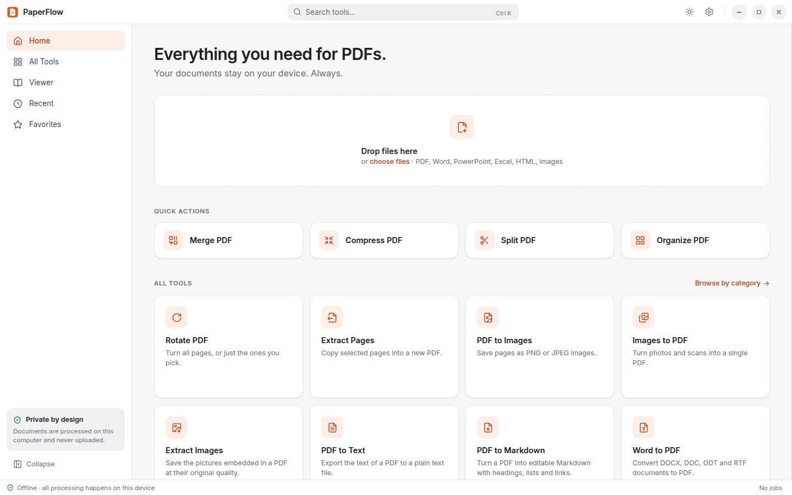
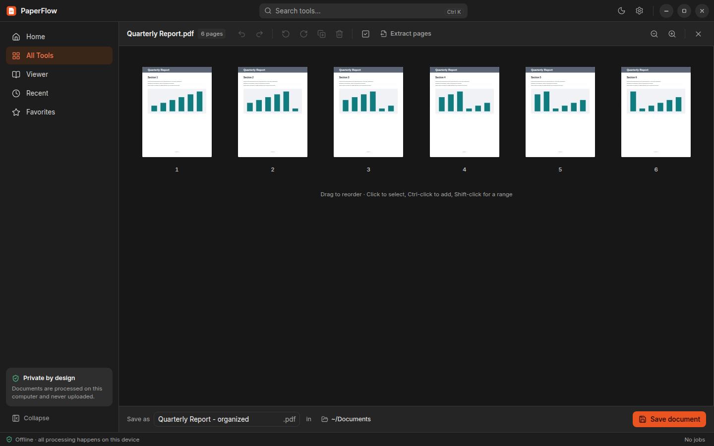
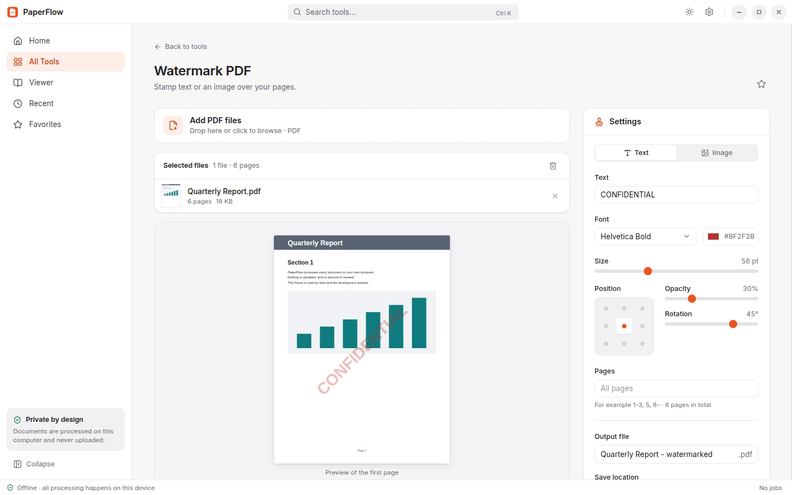

# PaperFlow

**Your PDFs. Your Device. Your Privacy.**

PaperFlow is an offline PDF toolkit for Linux. It merges, splits, compresses, organizes,
converts, watermarks, protects and OCRs PDF files, and turns Word, PowerPoint, Excel and HTML
files into PDFs, entirely on your computer. Nothing is uploaded, no account is needed, and every
tool works without an internet connection.



## Tools

| Organize | Optimize | Convert to PDF | Convert from PDF | Edit | Security | OCR |
| --- | --- | --- | --- | --- | --- | --- |
| Merge PDF | Compress PDF | Word to PDF | PDF to Images | Watermark PDF | Protect PDF | OCR PDF |
| Split PDF | | PowerPoint to PDF | PDF to Text | Page Numbers | Unlock PDF | |
| Organize PDF | | Excel to PDF | PDF to Markdown | Metadata Editor | | |
| Rotate PDF | | HTML to PDF | Extract Images | | | |
| Extract Pages | | Images to PDF | | | | |

There is also a PDF viewer with search, zoom, thumbnails and full screen. See
[docs/FEATURES.md](docs/FEATURES.md) for what each tool does.

| Page organizer | Watermark with live preview |
| --- | --- |
|  |  |

## Install

### Snap

```bash
sudo snap install paperflow
```

The snap runs under strict confinement and includes everything it needs: Ghostscript, Poppler,
qpdf, Tesseract with language data for 17 languages, and LibreOffice for Office and HTML files. It can read and write files in your
home folder and on removable drives, and has no network access.

To install a snap you built yourself or downloaded from a release:

```bash
sudo snap install --dangerous paperflow_0.2.0_amd64.snap
```

### Debian / Ubuntu package

Releases also include a `.deb`. It depends on the distribution's `ghostscript`,
`poppler-utils`, `qpdf` and `tesseract-ocr` packages, which `apt` installs with it, and
recommends LibreOffice for the Word, PowerPoint, Excel and HTML converters:

```bash
sudo apt install ./PaperFlow_0.2.0_amd64.deb
```

Every release comes with a `SHA256SUMS` file to check the downloads.

## Privacy

PaperFlow processes documents on your computer only. It has no telemetry, no analytics, no
accounts and no network access. Passwords are used once and never stored or logged. Recent
activity keeps only file names, the tool used and where the result was saved, and can be
turned off. See [docs/PRIVACY.md](docs/PRIVACY.md).

## Development

```bash
npm ci
```

```bash
eval "$(scripts/dev-engines.sh)"
```

```bash
npm run tauri dev
```

`scripts/dev-engines.sh` makes qpdf, Tesseract and LibreOffice available without root if your
system lacks them. Building, testing and packaging are described in [docs/BUILDING.md](docs/BUILDING.md), and
the design of the application in [docs/ARCHITECTURE.md](docs/ARCHITECTURE.md).

## Documentation

- [Features](docs/FEATURES.md)
- [Architecture](docs/ARCHITECTURE.md)
- [Building, testing and packaging](docs/BUILDING.md)
- [Privacy](docs/PRIVACY.md)
- [Dependencies and licenses](docs/DEPENDENCIES.md)

## License

PaperFlow is released under the [MIT License](LICENSE). The bundled processing engines keep
their own licenses; see [docs/DEPENDENCIES.md](docs/DEPENDENCIES.md).
